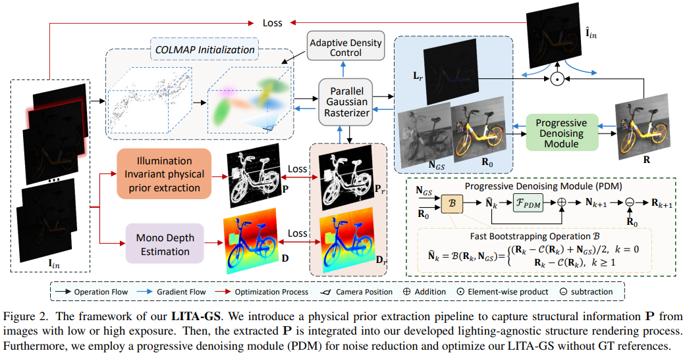

#  [CVPR 2025] LITA-GS: Illumination-Agnostic Novel View Synthesis via Reference-Free 3D Gaussian Splatting and Physical Priors [[Paper]](https://arxiv.org/pdf/2504.00219)

<h4 align="center"> Han Zhou<sup></sup>, Wei Dong<sup>&dagger;</sup>, Jun Chen<sup></sup></center>
<h4 align="center"> McMaster University, <sup>&dagger;</sup>Corresponding Author</center></center>
  
### Introduction
This repository represents the official implementation of our CVPR 2025 paper titled **LITA-GS: Illumination-Agnostic Novel View Synthesis via Reference-Free 3D Gaussian Splatting and Physical Priors**. If you find this repo useful, please give it a star ⭐ and consider citing our paper in your research. Thank you for your interest. 

[](https://www.apache.org/licenses/LICENSE-2.0)

## 📢 News
**2025-08-26** The code for underexposed scenes has been released！

### Overall Framework



## 🛠️ Setup

The code was tested on:

- RTX 5090, Python 3.9, CUDA 12.8, PyTorch 2.8 + cu12.8.

### 📦 Repository

Clone the repository (requires git):

```bash
git clone https://github.com/LowLevelAI/LITA-GS.git
cd LITA-GS
```

### 💻 Dependencies

- **Create the Conda environment:** 

    ```bash
    conda create -n litags python=3.9
    conda activate litags
    ```
- **Then install dependencies:**
  - Install Pytorch

  ```bash
  pip install --pre torch torchvision torchaudio --index-url https://download.pytorch.org/whl/nightly/cu128
  ```
  - Set Cudatoolkit to 12.8
  ```bash
  export PATH=/usr/local/cuda-12.8/bin:$PATH
  export LD_LIBRARY_PATH=/usr/local/cuda-12.8/lib64:$LD_LIBRARY_PATH
  ```
  - Install dependencies
  ```bash
  pip install trimesh tqdm mmcv==1.6.0 scipy scikit-image
  pip install submodules/diff-gaussian-rasterization
  pip install submodules/simple-knn
  ```

  ## 🏋️ Training

For underexposed scenes, we recommend using our generated [colmap reuslts](https://mcmasteru365-my.sharepoint.com/:u:/r/personal/dongw22_mcmaster_ca/Documents/25CVPR_LITAGS/LOM%20dataset%20with%20depth%20maps%20and%20structure%20priors.zip?csf=1&web=1&e=2ddEXR), where the overall brightness of underexposed images are adjusted to 0.2 or 0.49 before utilizing COLMAP software. Take the bike scene as an example, the training command could be：

```bash
python train_underexposed.py -s data/LOM_low_bike_colmap -m output/LOM_low_bike --config arguments/LOM/bike_low.py
```
The point clouds and testing outputs can be found in *output/LOM_low_bike*.

## ✏️ Contributing

Please refer to [this instruction](CONTRIBUTING.md).

## 🎓 Citation

If you find this repo and our paper useful, please consider citing our paper:

```bibtex
@inproceedings{zhou2025litags,
  title={LITA-GS: Illumination-Agnostic Novel View Synthesis via Reference-Free 3D Gaussian Splatting and Physical Priors},
  author={Zhou, Han and Dong, Wei and Chen, Jun},
  booktitle={Proceedings of the Computer Vision and Pattern Recognition Conference},
  pages={21580--21589},
  year={2025}
}
```

## Acknowledgement
This repo is built upon [Gaussian DK](https://github.com/yec22/Gaussian-DK). We thank the authors for their great job!
